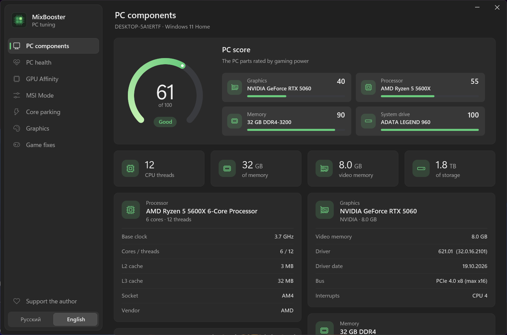
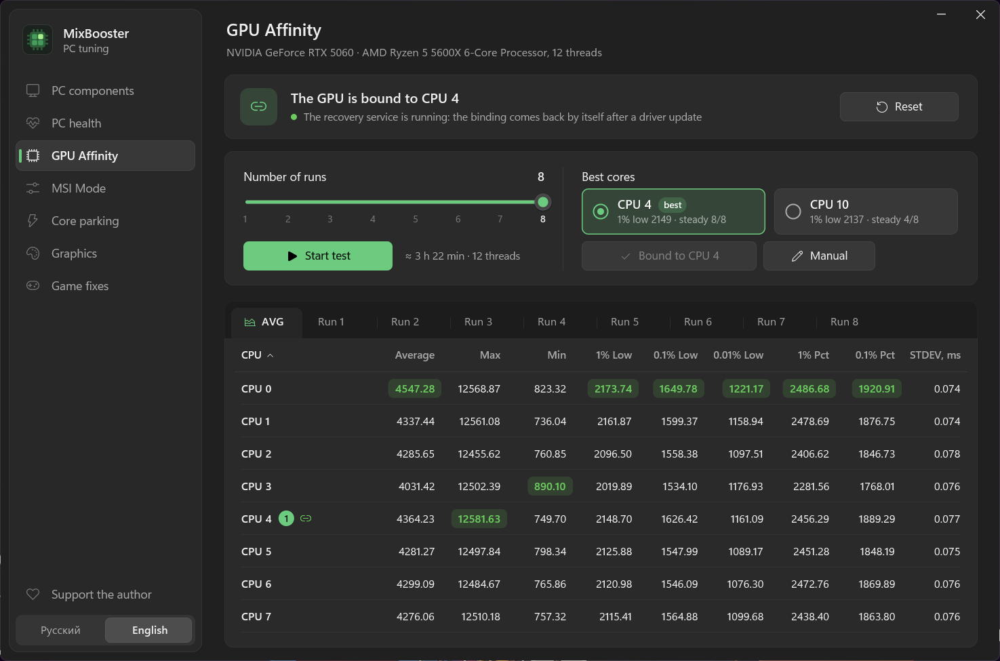
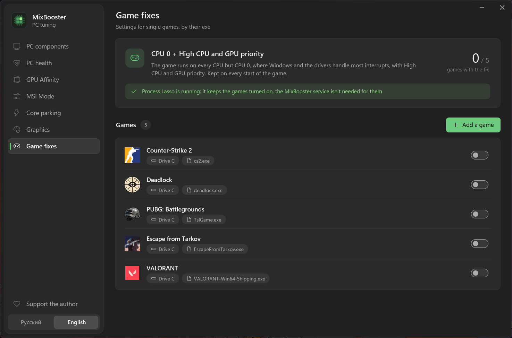
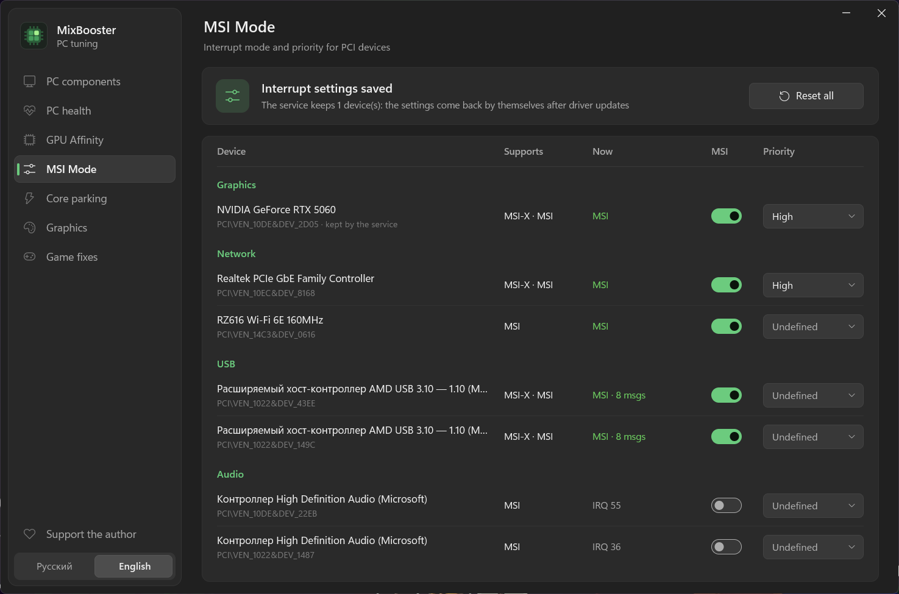
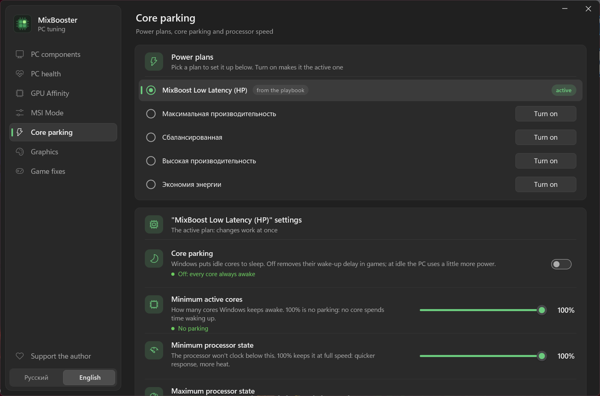
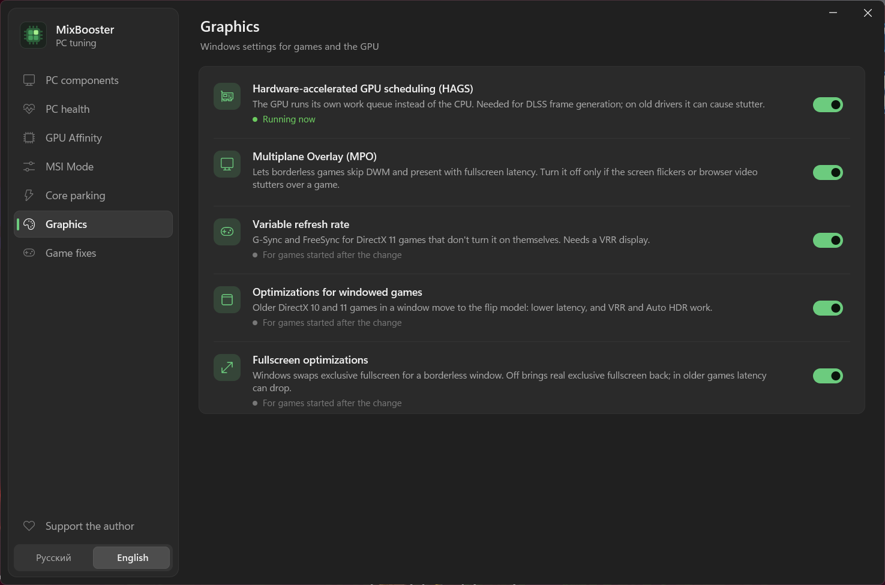
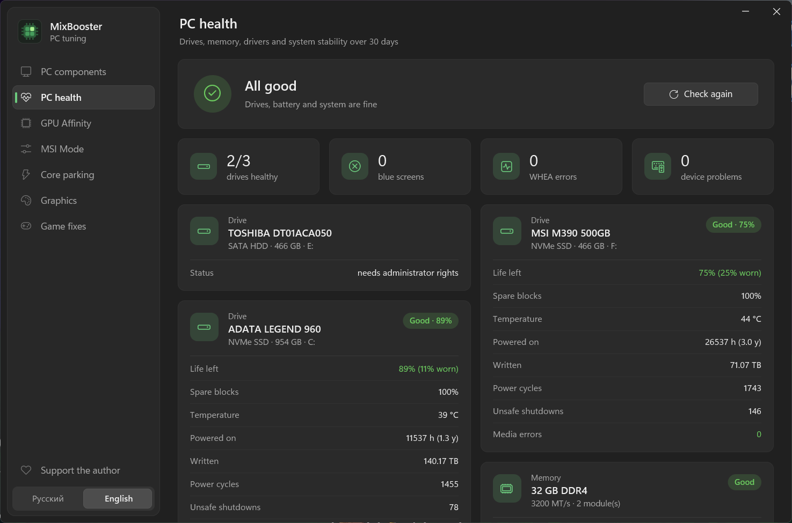

<p align="center">
  
</p>

<h1 align="center"> MixBooster</h1>

<p align="center">
  PC tuning for gaming on Windows 10 and 11.
</p>

<p align="center">
  
  
  
  
</p>

## Features

- **GPU Affinity.** Tests every CPU core with the GPU's interrupts on it and binds the GPU to the steadiest one.
- **MSI Mode.** MSI and interrupt priority for every PCI device, in one table.
- **Core parking.** Power plans, parking and processor state, with every core shown live; adds the MixBoost Low Latency plan.
- **Graphics.** HAGS, MPO, VRR, windowed and fullscreen optimizations in one place.
- **Game fixes.** CPU 0 off with High CPU and GPU priority for each game; finds Steam, Epic, Riot and Battle.net games and works with Process Lasso.
- **PC components and health.** A gaming score for the PC, drive health, memory, drivers, BSODs and WHEA errors.
- **Kept after driver updates.** A small service puts the GPU core, the MSI settings and the game fixes back.
- **No AI, no telemetry.**

## Screenshots

<table>
  <tr>
    <td align="center"><br>GPU Affinity</td>
    <td align="center"><br>Game fixes</td>
  </tr>
  <tr>
    <td align="center"><br>MSI Mode</td>
    <td align="center"><br>Core parking</td>
  </tr>
  <tr>
    <td align="center"><br>Graphics</td>
    <td align="center"><br>PC health</td>
  </tr>
</table>

## Build

```
build.bat          release -> build\MixBooster.exe (runs as administrator)
build.bat dev      no elevation prompt, for working on the UI
```

MSVC or MinGW-w64. How each page works and what it changes: [docs/how-it-works.md](docs/how-it-works.md).

Bundled: [liblava](https://github.com/liblava/liblava) and [PresentMon](https://github.com/GameTechDev/PresentMon), both MIT.
